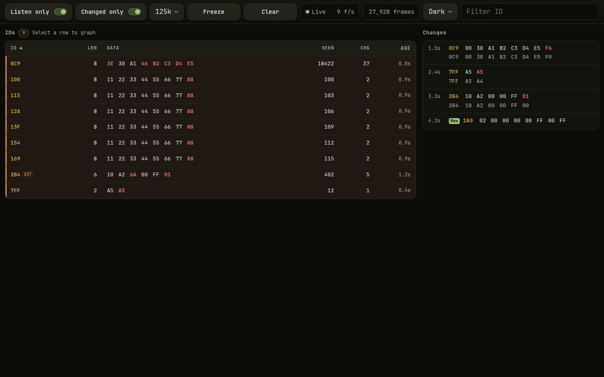
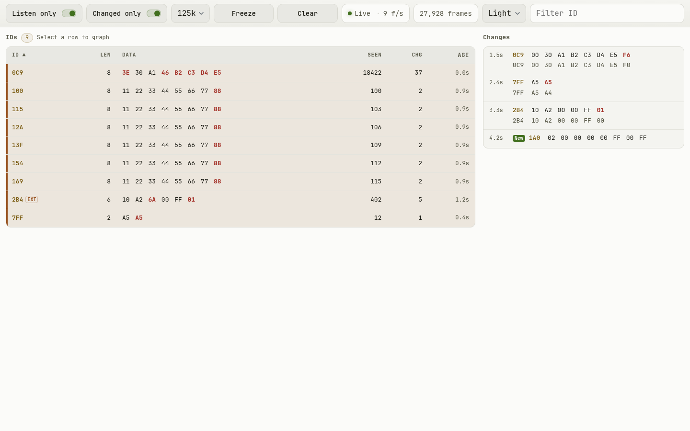
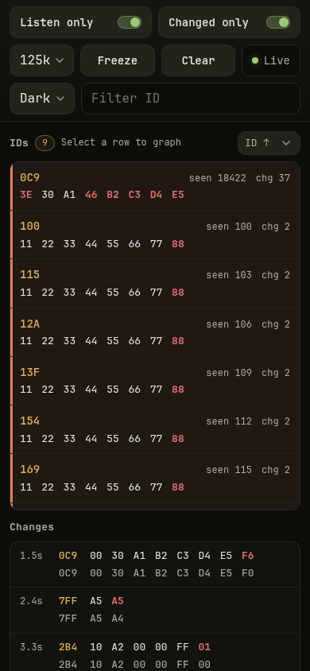

# Canwatch

[](https://www.espressif.com/)
[](https://ww1.microchip.com/downloads/en/DeviceDoc/MCP2515-Stand-Alone-CAN-Controller-with-SPI-20001801J.pdf)
[](https://en.wikipedia.org/wiki/CAN_bus)
[](https://www.arduino.cc/)
[](./LICENSE)
[]()

Read-only CAN bus monitor. ESP32 + MCP2515 sniffs up to 128 CAN IDs, tracks every
byte change, and serves a single-page web UI over WiFi from the board itself. No
app, no cloud, no PC middleware.



---

## Features

| | |
|---|---|
| **Listen-only by default** | MCP2515 stays in `ListenOnlyMode`, never ACKs, never transmits. Toggle to Normal from the UI only when you need it. |
| **Live ID table** | 128 slots, standard + extended IDs, length, current data, previous data, frame count, change count, age. |
| **Change log** | Rolling 60-entry history of every byte change, newest first. The previous payload sits directly under the current one in muted type, same ID/byte columns so you can eyeball the diff. |
| **Byte graph** | Select any row to plot its 8 bytes over the last 60 s (`180` samples @ 300 ms poll). |
| **Runtime bitrates** | 10k, 20k, 50k, 100k, 125k, 250k, 500k, 1M. Switch from the dropdown, rollback on failure. |
| **Freeze / Clear / Filter / Sort** | Pause the UI without stopping capture, wipe the tables, filter by ID, sort by any column. |
| **Changed-only mode** | Hide IDs that never changed a byte. |
| **Theme** | System / light / dark, defaults to the device scheme, saved in `localStorage`, olive-based palette in both modes — down to the graph colours. `?theme=light\|dark\|system` overrides without saving. |
| **Mobile-first UI** | Single HTML file in PROGMEM, no CDN, no assets, two-column layout on desktop, card rows on phones. |
| **AP fallback** | Joins your WiFi; if it can't within 10 s it prints nearby 2.4 GHz networks and starts its own AP. |

## Screenshots

Screenshots use simulated frames (no vehicle attached).

| Light | Phone |
|---|---|
|  |  |

## Hardware

- ESP32 dev board (any classic ESP32 with WiFi; tested against Arduino-ESP32 core)
- MCP2515 CAN controller module with an **8 MHz** crystal (16 MHz works, change `QUARTZ_FREQUENCY`)
- CAN transceiver on the module (TJA1050 / MCP2551 class) — module must be a full MCP2515 + transceiver board, powered from the ESP32 `5V` pin
- 4 wires to CAN_H / CAN_L / GND (+ termination if you're the only other node)

### Wiring (default pins)

| MCP2515 | ESP32 | Notes |
|---|---|---|
| `VCC` | `5V` | The usual blue MCP2515 module carries a TJA1050 transceiver plus its own regulator and level shifter, so it wants 5 V from the ESP32 `VIN`/`5V` pin. A bare 3.3 V MCP2515 board is the exception — feed that one `3V3`. |
| `GND` | `GND` | Common ground with the bus. |
| `CS`  | `GPIO26` | `MCP2515_CS` |
| `SCK` | `GPIO14` | `PIN_SCK` |
| `SI`  | `GPIO13` | `PIN_MOSI` |
| `SO`  | `GPIO27` | `PIN_MISO` |
| `INT` | not connected | Polled (`255` in the `ACAN2515` constructor). |
| `CAN_H` / `CAN_L` | bus | 120 Ω termination at both ends of the bus. |

Pins are defined at the top of `canwatch.ino` — change them there, not in the UI.

## Libraries

Install through **Library Manager** (Sketch → Include Library → Manage Libraries):

| Library | Author | Version | Used for |
|---|---|---|---|
| [`ACAN2515`](https://github.com/pierremolinaro/acan2515) | Pierre Molinaro | ≥ 2.1 | MCP2515 driver, bitrate timing, listen-only / normal mode switching |
| `SPI` | Arduino / ESP32 core | bundled | MCP2515 transport |
| `WiFi` | Arduino-ESP32 core | bundled | STA join + softAP fallback |
| `WebServer` | Arduino-ESP32 core | bundled | HTTP endpoints and the UI page |

`ACAN2515` depends on [`ACAN2515Settings`](https://github.com/pierremolinaro/acan2515) (shipped with it).
No other third-party code. The UI is plain HTML/CSS/JS with no framework and no build step.

## Build & flash

Arduino IDE:

1. **Boards Manager** → install `esp32` by Espressif.
2. **Library Manager** → install `ACAN2515` by Pierre Molinaro.
3. Board: *ESP32 Dev Module*, upload speed 921600, flash size default.
4. Open `canwatch.ino`, edit the settings block, upload.
5. Serial monitor at **115200** baud prints the IP it got.

No PlatformIO config in the repo — this is a single `.ino` sketch, Arduino IDE
is the intended path. Add a `platformio.ini` if you prefer; the board is
`esp32dev` and the only external dep is `pierremolinaro/ACAN2515`.

## Configuration

All settings are constants at the top of `canwatch.ino`.

```cpp
// MCP2515 crystal: 8 MHz is the common blue module. 16 MHz modules exist.
static const uint32_t QUARTZ_FREQUENCY = 8UL * 1000UL * 1000UL;

// Station: try to join this network first.
static const bool STA_ENABLE      = true;
static const bool STA_USE_DHCP    = true;      // false = use STA_IP / STA_GATEWAY / STA_SUBNET
static const char* STA_SSID       = "your-ssid";
static const char* STA_USERNAME   = "";        // set only for WPA2-Enterprise (PEAP)
static const char* STA_PASSWORD   = "your-password";
static const char* STA_IP         = "192.168.1.98";   // e.g. out of the router's DHCP pool
static const char* STA_GATEWAY    = "192.168.1.1";
static const char* STA_SUBNET     = "255.255.255.0";
static const uint8_t STA_TIMEOUT_SEC = 10;

// Access point fallback.
static const char* AP_SSID     = "Canwatch";
static const char* AP_PASSWORD = "";           // 8+ chars = WPA2, otherwise open
static const char* AP_IP       = "10.10.98.1";
```

Notes:

- ESP32 is **2.4 GHz only**. A 5 GHz-only SSID will never connect; the sketch
  scans and prints visible 2.4 GHz networks when the join fails.
- Leave `STA_USE_DHCP = true` unless you need a fixed address; the router then hands out an address that is always routable from every device on the LAN.
- If you do pin one, `STA_IP` must sit on the router's LAN with the router's own mask, must differ from `STA_GATEWAY`, and must not collide with the AP address. A mismatch (e.g. `/16` on a `/24` LAN) makes the board answer on the desktop that already has a route but look *unreachable* to phones.
- `AP_PASSWORD` under 8 characters silently means "open network" — the serial
  log says so.
- Credentials are compiled in. **Don't commit real ones.** Keep `STA_PASSWORD`
  empty or use a local uncommitted header/branch. `.gitignore` already excludes
  build output, not your sketch, so check before pushing.

## HTTP API

All endpoints are unauthenticated on the local network. Bind to your own
network, not a public one.

| Endpoint | Method | Body / params | Returns |
|---|---|---|---|
| `/` | GET | `?theme=light\|dark\|system` (optional) | The UI page (PROGMEM string); the query only overrides the saved theme for that load |
| `/data` | GET | — | Full state JSON (see below) |
| `/clear` | GET | — | `ok`, wipes IDs, log, counter |
| `/mode` | GET | `listen=1` or `listen=0` | `{"lo":0|1,"err":0}` |
| `/bitrate` | GET | `hz=125000` | `{"b":125000,"err":0}` — rolls back on error |

`/data` shape:

```json
{
  "t": 123456,          // millis() on the board
  "n": 4021,            // total frames seen
  "b": 125000,          // current bitrate
  "lo": 1,              // 1 = listen only
  "ids": [
    { "id": "18ff50e5x", "l": 8, "d": "0102030405060708",
      "p": "0102030405060700", "n": 912, "c": 3, "lc": 123000 }
  ],
  "log": [
    { "t": 123000, "id": "18ff50e5x", "d": "...", "p": "..." }
  ]
}
```

`id` is uppercase hex; a trailing `x` marks an extended (29-bit) ID. `p` is the
previous value, empty when never changed (or when the log entry is a first
sighting). `lc` is the `millis()` of the last change.

## How it works

1. `setup()` starts SPI, initialises `ACAN2515` in listen-only mode at 125 kbit/s,
   then joins WiFi or opens the AP.
2. `loop()` polls the controller (`can.poll()`), drains received frames into a
   fixed 128-entry table keyed by `(id, ext)`, and appends to a 60-entry ring
   buffer whenever a payload changes.
3. The browser polls `/data` every 300 ms, diffs nothing, and re-renders tables
   and the SVG graph from scratch. The graph keeps its own 180-sample history
   client-side, so bitrate changes reset it.
4. Bitrate change re-initialises the driver with new timing and clears the
   tables. If `begin()` fails, the old bitrate is restored.

No dynamic allocation of the tables — `MAX_IDS = 128` and `LOG_SIZE = 60` are
compile-time. Stored frames are dropped when the table is full.

## Limitations

- Read-only in intent: Normal mode exists but the sketch never transmits and
  never uses the TX buffers, so ACK/error-frame behaviour is all you get.
- Frames arriving faster than the poll loop + `/data` serialisation are counted
  in `n` but may be missed by the change log.
- One bitrate at a time. No auto-baud detection.
- No RTR payloads (skipped, still counted).
- `String`-based JSON building; fine at 128 IDs, don't raise `MAX_IDS` much
  without switching to a byte buffer.

## License

MIT — see [LICENSE](./LICENSE).
