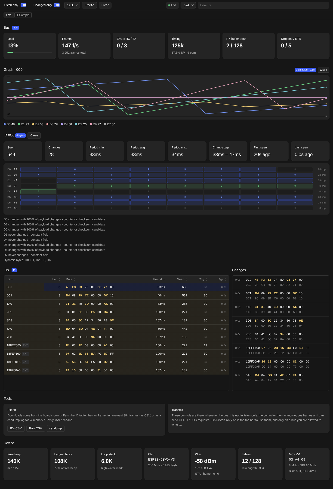
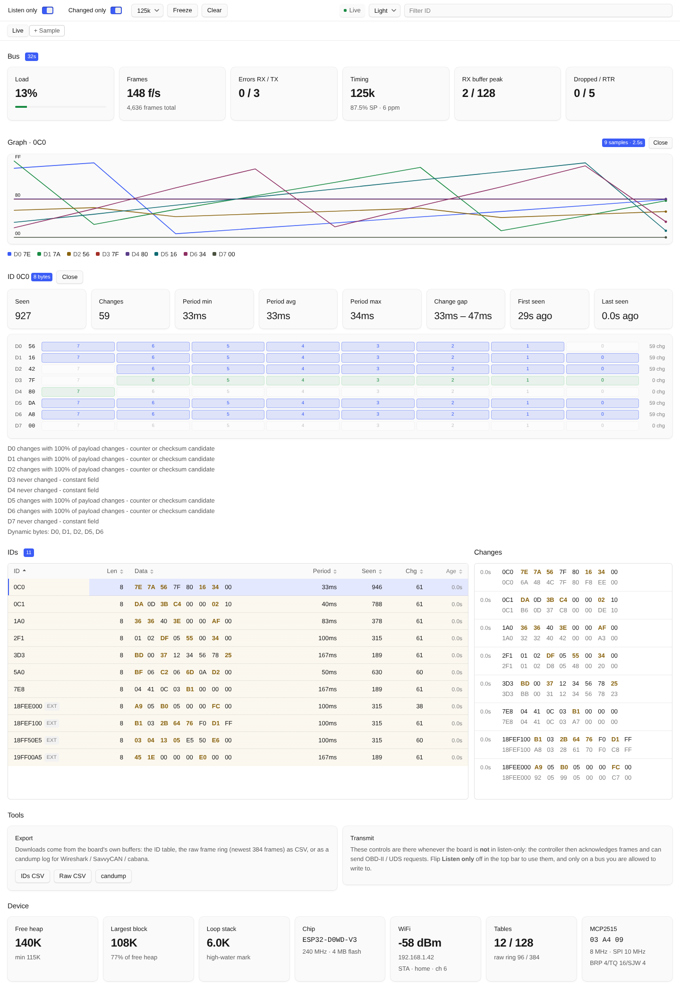
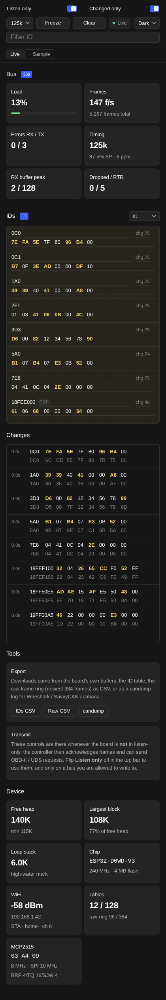

# Canwatch

[](https://www.espressif.com/)
[](https://ww1.microchip.com/downloads/en/DeviceDoc/MCP2515-Stand-Alone-CAN-Controller-with-SPI-20001801J.pdf)
[](https://en.wikipedia.org/wiki/CAN_bus)
[](https://www.arduino.cc/)
[](./LICENSE)
[]()

Read-only CAN bus monitor. ESP32 + MCP2515 sniffs up to 128 CAN IDs, tracks every
byte change, and serves a single-page web UI over WiFi from the board itself. No
app, no cloud, no PC middleware.

It also reports what the controller's own error counters say about the bus, keeps
per-ID timing and bit-level statistics that hint at counters and checksums, and can
optionally act as a diagnostic client (OBD-II / UDS) — that last part is off by
default and never used by the sniffer.



---

## Features

| | |
|---|---|
| **Listen-only by default** | MCP2515 stays in `ListenOnlyMode`, never ACKs, never transmits. Toggle to Normal from the UI only when you need it. |
| **Live ID table** | 128 slots, standard + extended IDs, length, current data, previous data, frame count, change count, cycle period, age. |
| **Bus health** | Load (with bar), frames/s + total, RX/TX error counters, latched MCP2515 `EFLG` flags (EWARN, TXWAR, RXWAR, TXEP, RXEP, BUS-OFF, RX0OVR, RX1OVR), achieved bitrate, sample point, timing error in ppm, RX buffer peak, dropped IDs, RTR count. Everything numeric lives in the cards; the top bar only carries connection state. A wrong bitrate or missing termination now says so instead of showing an empty table. |
| **Per-ID timing** | Period min / average / max from 64-bit microsecond timestamps, change-interval min/max, and a `LOST` badge when an ID goes quiet for 4× its own period. |
| **Bit-level analysis** | Per ID: which bits ever toggled, which bits are stuck at 0 or 1, per-byte change counts, and two heuristics — a 16-bit window that advances by a small step (rolling counter herringbone) and a byte that changes on every payload change (counter or checksum). |
| **Frame metadata** | RTR frames counted and flagged per ID, 29-bit IDs decoded as J1939 priority / PGN / source address. |
| **Device** | ESP32 headroom and module wiring in one row of cards: free heap + low-water mark, largest free block (fragmentation), loop-task stack high-water mark, chip model / CPU MHz / flash, network state (station: RSSI + IP + SSID + channel; access point: client count + AP IP + WPA2/open + SSID + channel), table + raw-ring occupancy, and the MCP2515 `CNF1/2/3` bytes actually programmed plus quartz, SPI clock, BRP/TQ/SJW. Same numbers go to the serial log once at boot. |
| **Exports** | ID table as CSV, raw ring buffer (newest 384 frames) as CSV or candump format, served straight from the board — Wireshark / SavvyCAN / cabana ready. |
| **Sampling tabs** | `+ Sample` freezes the current table into its own tab, then you swap the module, sample again, and repeat. A `Compare` tab diffs every sample against the first one: payload, length, period, missing IDs. Tabs survive a reload (`localStorage`, last 8 kept). |
| **Change log** | Rolling 60-entry history of every byte change, newest first. The previous payload sits directly under the current one in muted type, same ID/byte columns so you can eyeball the diff. |
| **Byte graph** | Select any row to plot its 8 bytes over the last 60 s (`180` samples @ 300 ms poll). |
| **Runtime bitrates** | 10k, 20k, 50k, 100k, 125k, 250k, 500k, 1M. Switch from the dropdown, rollback on failure. |
| **Freeze / Clear / Filter / Sort** | Pause the UI without stopping capture, wipe the tables, filter by ID, sort by any column. |
| **Changed-only mode** | Hide IDs that never changed a byte. |
| **Bus tools (opt-in, transmits)** | OBD-II PID scan, VIN, stored DTCs, and raw single-frame ISO-TP requests. There is no separate switch: the controls appear as soon as the board leaves listen-only, and disappearing again is what turning Listen only back on does. Compile-time gated too (`ALLOW_TX`), and the runtime gate re-closes on Clear, on a bitrate change and on returning to listen-only. |
| **Theme** | System / light / dark, defaults to the device scheme, saved in `localStorage`. Console-style chrome in both modes: grey layer ramp with a blue accent, ring-shadow cards (8 px radius, 24 px metrics), tables drawn as a surface frame around a raised body, 24×16 switches, segmented tabs, 28 px controls — down to the graph colours. `?theme=light\|dark\|system` overrides without saving. |
| **Mobile-first UI** | Single HTML file in PROGMEM, no CDN, no assets, two-column layout on desktop, card rows on phones. |
| **AP fallback** | Joins your WiFi; if it can't within 10 s it prints nearby 2.4 GHz networks and starts its own AP. |

## Screenshots

Simulated frames, no vehicle attached. One ID is selected in the desktop shots so
the byte graph, the bit map and the counter / checksum hints are on screen.

| Light | Phone |
|---|---|
|  |  |

Dark theme is the one at the top of this README. Bus health, the ID table, the
change log, Tools and Device are all sections of that single page.

## Hardware

- ESP32 dev board (any classic ESP32 with WiFi; tested against Arduino-ESP32 core)
- MCP2515 CAN controller module with an **8 MHz** crystal (16 MHz works, change `QUARTZ_FREQUENCY`)
- CAN transceiver on the module (TJA1050 / MCP2551 class) — module must be a full MCP2515 + transceiver board, powered from the ESP32 `5V` pin
- 4 wires to CAN_H / CAN_L / GND (+ termination if you're the only other node)

### Wiring (default pins)

| MCP2515 | ESP32 | Notes |
|---|---|---|
| `VCC` | `5V` | The usual blue MCP2515 module carries a TJA1050 transceiver plus its own regulator and level shifter, so it wants 5 V from the ESP32 `VIN`/`5V` pin. A bare 3.3 V MCP2515 board is the exception — feed that one `3V3`. |
| `GND` | `GND` | Common ground with the bus. |
| `CS`  | `GPIO26` | `MCP2515_CS` |
| `SCK` | `GPIO14` | `PIN_SCK` |
| `SI`  | `GPIO13` | `PIN_MOSI` |
| `SO`  | `GPIO27` | `PIN_MISO` |
| `INT` | not connected | Polled (`MCP2515_INT = 255`). Wire it to a free GPIO and set `MCP2515_INT` to that pin for interrupt capture: frames are then buffered in the driver's 128-frame software ring instead of waiting for the next poll. |
| `CAN_H` / `CAN_L` | bus | 120 Ω termination at both ends of the bus. |

Pins are defined at the top of `canwatch.ino` — change them there, not in the UI.

## Libraries

Install through **Library Manager** (Sketch → Include Library → Manage Libraries):

| Library | Author | Version | Used for |
|---|---|---|---|
| [`ACAN2515`](https://github.com/pierremolinaro/acan2515) | Pierre Molinaro | ≥ 2.1 | MCP2515 driver, bitrate timing, listen-only / normal mode switching |
| `SPI` | Arduino / ESP32 core | bundled | MCP2515 transport |
| `WiFi` | Arduino-ESP32 core | bundled | STA join + softAP fallback |
| `WebServer` | Arduino-ESP32 core | bundled | HTTP endpoints and the UI page |

`ACAN2515` depends on [`ACAN2515Settings`](https://github.com/pierremolinaro/acan2515) (shipped with it).
No other third-party code. The UI is plain HTML/CSS/JS with no framework and no build step.

## Build & flash

Arduino IDE:

1. **Boards Manager** → install `esp32` by Espressif.
2. **Library Manager** → install `ACAN2515` by Pierre Molinaro.
3. Board: *ESP32 Dev Module*, upload speed 921600, flash size default.
4. Open `canwatch.ino`, edit the settings block, upload.
5. Serial monitor at **115200** baud prints the IP it got.

No PlatformIO config in the repo — this is a single `.ino` sketch, Arduino IDE
is the intended path. Add a `platformio.ini` if you prefer; the board is
`esp32dev` and the only external dep is `pierremolinaro/ACAN2515`.

`canwatch_frame_stats.h` in the same folder holds the per-ID statistics and has a
host-side check that needs no hardware:

```sh
g++ -std=c++11 -Wall -o /tmp/frame_stats_test test/frame_stats_test.cpp && /tmp/frame_stats_test
python3 test/prototype_order.py   # the IDE inserts prototypes before the first function
```

`prototype_order.py` guards a real Arduino-IDE-only failure: the IDE generates
function prototypes and inserts them directly above the first function in the
sketch, so every struct used in a signature (`Entry`, `Out`, ...) has to be
declared above that point. A plain `g++` compile does not catch this.

## Serial log

115200 baud, and it narrates the whole network bring-up, so a board that never
answers HTTP still tells you what it is doing:

```
Canwatch: boot, reset reason 3, heap 289000
WiFi: STA_ENABLE=1 SSID=home DHCP=1 timeout=10s
CAN: INT pin 255 (polling), quartz 8000000 Hz
CAN: MCP2515 ok at 125000 bit/s, listen only
WiFi: joining "home" as DHCP, timeout 10s
  0s status 0: idle
  1s status 3: connected
WiFi: associated with "home" (channel 6), waiting for an address
WiFi: got an address
  mode     STA   mac 24:6F:28:xx:xx:xx
  ssid     "home"  channel 6
  ip       10.10.90.42  mask 255.255.255.0
  gateway  10.10.90.1  dns 10.10.90.1
  url      http://10.10.90.42
  signal   -54 dBm  bssid 3C:37:86:xx:xx:xx
  heap     289000 bytes free
resources: heap 289000 free (min 288000), largest block 278528, loop stack hwm 6096, cpu 240 MHz
board: ESP32-D0WD-V3 rev 3, 2 cores, flash 4 MB, sketch 718 KB
mcp2515: quartz 8000 kHz, spi 10000 kHz, CNF 03 A4 09, BRP 4, TQ 16, SJW 4, sample point 87.50%
HTTP: endpoints /data /detail /ids.csv /raw.csv /raw.log /tx /obd /vin /dtc
HTTP: ready
up 30s | frames 4021 | STA 10.10.90.42 | heap 281000
```

- `wifiMonitor()` runs once a second: it logs every status change, retries a
  dropped station link (10 s → 20 s → 40 s → 60 s backoff), prints the full
  block when the link comes back, and prints an `up .../frames .../heap` line
  every 30 s.
- `printResources()` prints the same numbers the Device section shows once at
  boot — heap, largest free block, loop stack high-water mark, CPU, flash and
  sketch size, then the MCP2515 timing registers. Useful when the board reboots
  under load or the bus misbehaves at a non-standard bitrate.
- AP mode logs the interface, its IP and client joins/leaves.
- A failed join prints the timeout status and a scan of visible 2.4 GHz networks
  with channel, RSSI and open/locked before falling back to the AP.
- Mode and bitrate changes print their own lines (`CAN mode -> ...`,
  `CAN bitrate -> ...`).
- A failed `can.begin()` is retried three times, then decoded bit by bit, for
  example `0x2000 - ISR given but MCP2515_INT is 255 (no INT pin wired)` or
  `0x0001 - MCP2515 does not answer on SPI - check CS/SCK/SI/SO, 5V and GND`.
  The board keeps running with the bus down, so the UI still loads and shows a
  `CAN DOWN` flag; fix the wiring and change bitrate (or power-cycle) to retry.

## Configuration

All settings are constants at the top of `canwatch.ino`.

```cpp
// MCP2515 crystal: 8 MHz is the common blue module. 16 MHz modules exist.
static const uint32_t QUARTZ_FREQUENCY = 8UL * 1000UL * 1000UL;

// Station: try to join this network first.
static const bool STA_ENABLE      = true;
static const bool STA_USE_DHCP    = true;      // false = use STA_IP / STA_GATEWAY / STA_SUBNET
static const char* STA_SSID       = "your-ssid";
static const char* STA_USERNAME   = "";        // set only for WPA2-Enterprise (PEAP)
static const char* STA_PASSWORD   = "your-password";
static const char* STA_IP         = "192.168.1.98";   // e.g. out of the router's DHCP pool
static const char* STA_GATEWAY    = "192.168.1.1";
static const char* STA_SUBNET     = "255.255.255.0";
static const uint8_t STA_TIMEOUT_SEC = 10;

// Wiring. 255 = poll only; any other pin = use the MCP2515 INT line.
static const byte MCP2515_INT = 255;

// Compile-time gate for everything that can transmit (OBD-II / UDS / raw requests).
// Set to false and the transmit endpoints and UI are inert even if someone enables them.
static const bool ALLOW_TX = true;

// Access point fallback.
static const char* AP_SSID     = "Canwatch";
static const char* AP_PASSWORD = "";           // 8+ chars = WPA2, otherwise open
static const char* AP_IP       = "10.10.98.1";
```

Notes:

- ESP32 is **2.4 GHz only**. A 5 GHz-only SSID will never connect; the sketch
  scans and prints visible 2.4 GHz networks when the join fails.
- Leave `STA_USE_DHCP = true` unless you need a fixed address; the router then hands out an address that is always routable from every device on the LAN.
- If you do pin one, `STA_IP` must sit on the router's LAN with the router's own mask, must differ from `STA_GATEWAY`, and must not collide with the AP address. A mismatch (e.g. `/16` on a `/24` LAN) makes the board answer on the desktop that already has a route but look *unreachable* to phones.
- `AP_PASSWORD` under 8 characters silently means "open network" — the serial
  log says so.
- Credentials are compiled in. **Don't commit real ones.** Keep `STA_PASSWORD`
  empty or use a local uncommitted header/branch. `.gitignore` already excludes
  build output, not your sketch, so check before pushing.

## HTTP API

All endpoints are unauthenticated on the local network. Bind to your own
network, not a public one.

| Endpoint | Method | Body / params | Returns |
|---|---|---|---|
| `/` | GET | `?theme=light\|dark\|system` (optional) | The UI page (PROGMEM string); the query only overrides the saved theme for that load |
| `/data` | GET | — | Full state JSON (see below) |
| `/data?full=1&from=0&count=64` | GET | `from` = skip this many stored IDs, `count` ≤ 64 | One page of the table with every per-ID statistic (`r,o,a,t,bc,cu,cm,cx`), no change log, `"more":0\|1` tells the caller to ask for the next page. This is what a sampling tab reads; a capture is 1..N requests |
| `/detail` | GET | `id=18FF50E5x` | Bit map, per-byte change counts, counter hints, period stats, J1939 fields for one ID |
| `/ids.csv` | GET | — | ID table as CSV (download) |
| `/raw.csv` | GET | — | Raw frame ring as CSV: `seq,time_us,id,ext,rtr,len,data` |
| `/raw.log` | GET | — | Raw frame ring in candump format `(t) can0 ID#DATA` |
| `/clear` | GET | — | `ok`, wipes IDs, log, raw ring, counters |
| `/mode` | GET | `listen=1` or `listen=0` | `{"lo":0\|1,"err":0,"tx":0\|1}` |
| `/bitrate` | GET | `hz=125000` | `{"b":125000,"err":0}` — rolls back on error |
| `/tx` | GET | `en=1` or `en=0` | `{"tx":0\|1,"err":0}` — refuses `en=1` while in listen-only (`err=2`) or when `ALLOW_TX` is false (`err=1`). The page calls this for you when the Listen only toggle goes off |
| `/req` | GET | `id=7DF&data=02010C` | Sends one ISO-TP single frame, returns `{"ok":1,"src":"7E8","d":"..."}` |
| `/obd` | GET | `pid=0C` (optional) | No `pid`: scans supported PIDs and returns decoded values. With `pid`: raw response for that PID |
| `/vin` | GET | — | `{"ok":1,"vin":"..."}` (mode 09 PID 02, multi-frame ISO-TP) |
| `/dtc` | GET | — | `{"ok":1,"mil":0,"count":1,"codes":["P0301"]}` (modes 01 PID 01 + 03) |

`/tx`, `/req`, `/obd`, `/vin` and `/dtc` return `{"ok":0,"e":"..."}` and transmit
nothing unless the runtime gate is on and the bus is in normal mode.

`/data` shape:

```json
{
  "t": 123456,          // board uptime, ms
  "n": 4021,            // total frames seen
  "b": 125000,          // current bitrate
  "lo": 1,              // 1 = listen only
  "tx": 0,              // 1 = transmit gate open
  "atx": 1,             // 0 = this build has ALLOW_TX = false, transmit compiled out
  "h": {                // bus health
    "canok": 1,         // 0 = MCP2515 never initialised, everything below is stale
    "load": 137,        // bus load, per mille
    "rec": 0, "tec": 3, // error counters
    "eflg": 64,         // current EFLG bits
    "efl": 192,         // latched EFLG bits since clear
    "abr": 125000, "ppm": 0, "sp": 8750,   // achieved rate, timing error, sample point %
    "peak": 128, "rxsz": 128,               // RX ring peak / size
    "drop": 2, "rtr": 5                     // IDs dropped (table full) / RTR frames
  },
  "sys": {              // board + controller resources, live poll only (not on ?full=1)
    "heap": 142864, "hmin": 118240,        // free heap now / low-water mark, bytes
    "blk": 110592,                         // largest free block, bytes
    "stack": 6096,                         // loop task stack high-water mark, bytes
    "cpu": 240, "cores": 2, "chip": "ESP32-D0WD-V3",
    "flash": 4096, "sketch": 718,          // KB
    "ip": "192.168.1.42", "rssi": -58,     // 0 / "0.0.0.0" when not joined
    "ap": 0, "apcli": 0, "apsec": 0,       // access-point mode, clients on it, WPA2 vs open
    "chan": 6, "ssid": "home",             // AP SSID in AP mode, else the joined one
    "ids": 12, "idsz": 128, "raw": 96, "rawsz": 384,   // table + raw ring occupancy
    "quartz": 8000, "spi": 10000,          // kHz
    "brp": 4, "tq": 16, "sjw": 4,
    "cnf1": 3, "cnf2": 164, "cnf3": 9      // MCP2515 registers, decimal
  },
  "ids": [
    { "id": "18FF50E5x", "l": 8, "d": "0102030405060708",
      "p": "0102030405060700", "n": 912, "c": 3,
      "lc": 123000, "fs": 1000, "ls": 123450,
      "pm": 19900, "pa": 20010, "px": 20500 }
  ],
  "log": [
    { "t": 123000, "id": "18FF50E5x", "d": "...", "p": "..." }
  ]
}
```

`id` is uppercase hex; a trailing `x` marks an extended (29-bit) ID. `p` is the
previous value, empty when never changed (or when the log entry is a first
sighting). `lc` / `fs` / `ls` are the board uptime in ms at the last change,
first sighting and last frame. `pm` / `pa` / `px` are the cycle period in
microseconds: minimum, average, maximum (0 = not sampled yet). Timestamps come
from `esp_timer_get_time()`, so nothing wraps after 49 days.

`sys` is only in the live poll; the `?full=1` sample pages leave it out so
they stay small. `cnf1..3` are the bytes the ACAN2515 library packs from the
same settings, so they match what the controller really has.

## How it works

1. `setup()` starts SPI, initialises `ACAN2515` in listen-only mode at 125 kbit/s
   with a 128-frame software RX ring, then joins WiFi or opens the AP.
2. `loop()` drains received frames into a fixed 128-entry table keyed by
   `(id, ext)`, appends to a 60-entry change ring when a payload changes, and to a
   384-entry raw ring on every frame. With `MCP2515_INT` wired the controller
   raises an interrupt instead and the driver's own task buffers frames, so HTTP
   work no longer costs frames.
3. Per ID, `canwatch_frame_stats.h` updates the period statistics, the ever-0 /
   ever-1 / toggled bit masks and the 16-bit "steps by 1..8" window counters.
   Nothing is allocated: all of it lives in the table entry.
4. The browser polls `/data` every 300 ms and re-renders tables and the SVG graph
   from scratch. The graph keeps its own 180-sample history client-side, so a
   bitrate change resets it. `/detail` is fetched once per second for the open ID.
5. Bitrate change re-initialises the driver with new timing and clears the
   tables. If `begin()` fails, the old bitrate is restored.
6. Sampling tabs are browser-side only: `+ Sample` pages through
   `/data?full=1`, stores the pages as one snapshot and keeps it out of the live
   path, so the board needs no extra RAM for it. The `Compare` tab diffs each
   snapshot against the first: a cell differs when payload, length or average
   period differs, missing IDs are called out, and `differences only` (default)
   hides the rows that agree. `Download CSV` writes the whole matrix.
7. Transmit is a separate, gated path: `/tx?en=1` only works in normal mode, and
   requests go out as one ISO-TP single frame with a blocking (≤500 ms) wait for
   the reply, during which the sniffer keeps draining frames. Flow control is
   answered for multi-frame replies (VIN, DTC lists).

No dynamic allocation of the tables — `MAX_IDS = 128`, `LOG_SIZE = 60`,
`RAW_SIZE = 384` are compile-time. New IDs are dropped (and counted) when the
table is full.

## Bus tools (transmitting)

Everything under Tools → Transmit leaves the passive role. Listen-only must be
switched off first, `ALLOW_TX` must be true at compile time, and the gate is off
at boot; it re-closes on Clear, on a bitrate change and whenever the controller
returns to listen-only.

**Do not leave listen-only on a vehicle bus you do not own or on a bus with ECUs
that must keep running.** The board starts acknowledging frames the moment the
**Listen only** toggle goes off, and a malformed request can put an ECU into an
unexpected state. That toggle is the only gate: while it is on, the transmit
controls are not even rendered and `/req`, `/obd`, `/vin`, `/dtc` answer
`listen-only mode`. Use it on a bench harness, a simulator, or a bus you are explicitly
allowed to write to. Requests are single-frame only (7 bytes): there is no
multi-frame transmit and no flow-control state machine on the TX side.

What it gives you: the OBD-II PID scan (load, coolant, fuel trims, RPM, speed,
MAP, MAF, throttle, and more, only the PIDs the ECU reports as supported), VIN,
stored DTCs with MIL state, and a raw request box for any `11-bit id` +
`hex payload` (UDS on `7E0`, KWP, manufacturer PIDs).

## Limitations

- Read-only by default: the sniffer itself never transmits. Normal mode exists,
  and the transmit gate is opt-in and re-closes on every reset path.
- Bus load is estimated from `47/67 + 8·DLC` bits per frame plus ~20% average
  bit stuffing, not measured.
- Frames arriving faster than the RX ring drain are still counted in `n` but may
  be missed by the change log. Watch the RX buffer peak and the `RX0OVR` /
  `RX1OVR` flags; wire `MCP2515_INT` if it saturates.
- The software RX ring is 128 frames and the raw ring 384 frames (≈12 KB of
  static RAM, which also holds the 40 KB JSON buffer).
- One bitrate at a time. No auto-baud detection.
- No RTR payloads: RTR frames are counted and flagged, not decoded.
- ISO-TP receive buffers 64 bytes; longer multi-frame replies are truncated.
- Samples live in the browser, not on the board: a different phone or a cleared
  site data loses them. Up to 8 are kept, and a snapshot is whatever `/data`
  reported at that instant (up to 128 IDs) — it is not a frame capture, so use
  `/raw.csv` when you need every frame.
- Every bitrate change re-runs `ACAN2515::begin()`, which leaks one driver task
  on ESP32 (library limitation). Fine for a handful of switches.

## License

MIT — see [LICENSE](./LICENSE).
